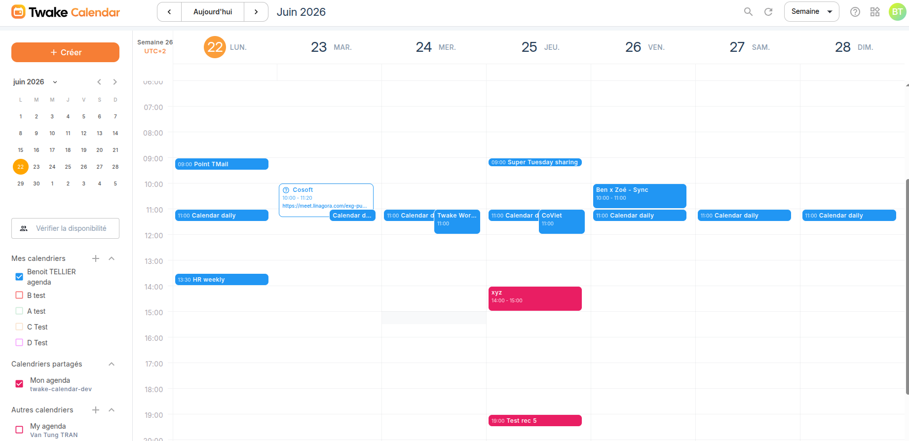

# Twake Calendar Frontend




## Goals

This project aims at serving a Single Page Application allowing a user to interact with its calendar.

This frontend application is built in a monorepo structure with Rsbuild, React, and TypeScript. It interacts with:

- [esn-sabre](https://github.com/linagora/esn-sabre/) CalDAV + CardDAV server, tailor made for LINAGORA needs.
- [Twake Calendar side service](https://github.com/linagora/twake-calendar-side-service) that delivers additional backend features for Sabre.

It is meant as a drop-in replacement of [esn-frontend-calendar](https://github.com/linagora/esn-frontend-calendar).

---

## Project Structure

The repository is organized as a monorepo workspace:

- **[`apps/private`](apps/private)**: The main private calendar application. Accessible by authenticated users.
- **[`apps/public`](apps/public)**: The public calendar application. Used for public event previews and shared links.
- **[`common`](common)**: Shared components, hooks, translation locales, and utility functions used by both applications.

---

## Frontend Routes

### Private App (`apps/private`)

| Route | Description |
|-------|-------------|
| `/` | Login handler |
| `/calendar` | Main calendar view (authenticated) |
| `/events/:uid` | Deep link that opens the event identified by `uid` once the calendar is loaded (going through the login flow first when needed) |
| `/newEvent?attendee=alice@example.com` | Deep link that opens the create-event modal with the attendee(s) prefilled. Accepts several attendees, either repeated (`?attendee=a@x.com&attendee=b@x.com`) or comma separated (`?attendee=a@x.com,b@x.com`) |
| `/callback` | OAuth callback |
| `/error` | Error page |

### Public App (`apps/public`)

| Route | Description |
|-------|-------------|
| `/excal?jwt=${token}` | Event preview via JWT token |
| `/booking/${bookingLinkPublicId}` | Public booking page for a shared link |

---

## Contributing

### Formatting

We use `rs fmt` of [Rstack](https://rstack.rs), which runs [Prettier](https://prettier.io/), to keep code style consistent.
The formatting rules are set in `rstack.config.mjs`.

Before committing, format your files:

```bash
npm run fmt
```

---

## Running it

Requirement: **Node 24.15.0 or later in the 24.x line**

First, install the dependencies from the root directory:

```bash
npm install
```

### Development Mode

To start the applications in development mode, use the following commands:

- **Private Application**:

  ```bash
  npm run start:private
  ```

  Runs the private app on [http://localhost:5000](http://localhost:5000).

- **Public Application**:
  ```bash
  npm run start:public
  ```
  Runs the public app on [http://localhost:5001](http://localhost:5001).

### Production Build

To build the applications for production, run:

- **Build Both Apps**:

  ```bash
  npm run build
  ```

- **Build Private App Only**:

  ```bash
  npm run build:private
  ```

- **Build Public App Only**:
  ```bash
  npm run build:public
  ```

The production bundles will be compiled to `apps/private/dist` and `apps/public/dist` respectively.

### Serving Locally

You can serve the built production assets locally using:

- **Serve Private App**:

  ```bash
  npm run serve:private
  ```

  Serves on [http://localhost:5000](http://localhost:5000).

- **Serve Public App**:
  ```bash
  npm run serve:public
  ```
  Serves on [http://localhost:5001](http://localhost:5001).

### Running Tests

Launches the Vitest test runner:

```bash
npm test
```

### Running the end to end tests

[`e2e/`](e2e) holds a Playwright + JUnit suite that drives a real browser against the
production frontend image, a real backend (esn-sabre + twake-calendar-side-service) and a real
OIDC provider, all in docker. It runs on every CI build.

```bash
cd e2e
./pre-build.sh
mvn clean test
```

See [`e2e/README.md`](e2e/README.md) for how to write a test, watch the browser work, and read
the traces left behind by a failure, and [`e2e.md`](e2e.md) for the backlog of scenarios left
to cover.

### Linting

To run the [Rslint](https://rslint.rs) checks and the format check:

```bash
npm run lint
npm run lint:fmt
```

To automatically fix formatting and lint errors:

```bash
npm run lint:fix
```

---

## Running with Docker

First, build the applications:

```bash
npm run build
```

Then build the Docker image for the specific application:

```bash
# For private app:
docker build -f apps/private/Dockerfile -t linagora/twake-calendar-private .

# For public app:
docker build -f apps/public/Dockerfile -t linagora/twake-calendar-public .
```

To run the container, mount the `.env.js` configuration file from the root `public/` directory:

```bash
docker run -d \
  -v $PWD/public/.env.js:/usr/share/nginx/html/.env.js \
  -p 5000:80 \
  linagora/twake-calendar-private
```

To let other pages frame the application, list their origins in `FRAME_ANCESTORS`. It is required for the embed routes. It is sent as the `frame-ancestors` of a `Content-Security-Policy` header. When it is unset, that header is `frame-ancestors 'self'`: no other page can frame the application. In the private image, the intents page, `/intents` and every path under it, is the exception: its header is `frame-ancestors` followed by `INTENT_FRAME_ANCESTORS`, `*` when it is unset, whatever `FRAME_ANCESTORS` says (see [Cozy-stack intents](#cozy-stack-intents)). With `*`, the handshake of cozy-interapp and its `requireFrameAncestors` check still keep the intent to its client. Both images also send `X-Content-Type-Options: nosniff`.

```bash
docker run -d \
  -e FRAME_ANCESTORS="https://space.example.com" \
  -v $PWD/public/.env.js:/usr/share/nginx/html/.env.js \
  -p 5000:80 \
  linagora/twake-calendar-private
```

TwakeSpace frames the team calendar of a space on `/embed/calendars/<team calendar id>`. The page signs in silently (`prompt=none`), so TwakeSpace, the application and the SSO portal must be served on one registrable domain.

The frame follows the contract of [`@linagora/twake-embed`](https://github.com/linagora/twake-libs/tree/main/packages/twake-embed): TwakeSpace greets the frame on each of its loads and the application answers the origin that greeted it, so the application needs no address of TwakeSpace and `FRAME_ANCESTORS` is the one setting that says who may frame it. TwakeSpace owns the browser history and moves the frame from one calendar to another with its `load` and `navigate` messages, the application reports its URL and never adds an entry, and tells TwakeSpace when the silent sign in is refused. `/embed/overlay.html` is the empty page TwakeSpace frames as the overlay of the application: its dialogs and drawers render there, over the whole page of TwakeSpace.

### Cozy-stack intents

Another app of the Workplace asks Twake Calendar for a new event with a cozy-stack intent, as Twake Chat does in a room: `intents.create('CREATE', 'io.cozy.calendar.events', { attendees })` of [cozy-interapp](https://github.com/cozy/cozy-libs/tree/master/packages/cozy-interapp). The stack frames the service of the intent, `/intents?intent=<id>`, in a dialog of that app.

| Action   | Type                      | Data                       | Result                              |
| -------- | ------------------------- | -------------------------- | ----------------------------------- |
| `CREATE` | `io.cozy.calendar.events` | `{ attendees?: string[] }` | the event created, or `null` if not |

- **Data**: `attendees` are e-mail addresses, the attendees of the new event. An address that is not an e-mail address is dropped; data of another shape fails the intent.
- **Result**: once the server saved the event, `{ uid, title, start, end, allDay, timeZone, videoConferenceUrl, url }`: `start` and `end` in ISO 8601 (an all-day event from midnight UTC of its first day to midnight UTC of the day after its last, as `DTEND`), `videoConferenceUrl` null without a video conference, `url` the event in the calendar (`/events/<uid>`). Closed or cancelled without saving, or once the user closed the message shown when there is no calendar to save into, the client gets `null`. A failed save shows the calendar's error and keeps the form as the user filled it; a second submit while the first is saving is ignored.
- **The page** (`apps/private/src/IntentsApp.tsx`, `common/src/features/intents/`) shows the form alone, without the Twake bar, hides the close button of the client (the form has its own), and never adds a history entry. It signs in silently (`prompt=none`) and comes back from the SSO to `/intents/callback`, its own redirect URI. It trades the ID token for a token of the stack of the user (the same platform session as the Drive picker), reads the intent, and waits for the client to answer from the origin the stack gives for it: nothing but a loader until then, and an error after 30 s. It reads the data of the client once, when the client answers. A page framed by an origin the stack does not allow for the intent (`frameAncestors`), or an intent without them, cancels the intent (cozy-interapp, `requireFrameAncestors`). When it cannot serve the intent (not framed, the stack refuses the token or the intent, the user or the calendars cannot be loaded, the form crashes, the session ended, another intent, data of another shape) it says why; once it knows the client, the client gets the error. A save in flight is waited for first: saved, the client gets the event.

The platform has to declare the intent:

- the manifest of the `calendar` app ([cozy/cozy-twakecalendar](https://github.com/cozy/cozy-twakecalendar)) declares the intent `CREATE io.cozy.calendar.events` with the `href` `/intents`, and `service_url_flag: calendar.embedded-app-url`, the flag that gives the stack the address of Twake Calendar;
- `oidc.app_token_exchange` of the stack maps the OIDC client of Twake Calendar to `registry://calendar`, for the token exchange;
- the SSO lists `https://<calendar>/intents/callback` among the redirect URIs of that client;
- cozy-stack with [linagora/cozy-stack#4965](https://github.com/linagora/cozy-stack/pull/4965) and [#4978](https://github.com/linagora/cozy-stack/pull/4978) (`frameAncestors` of the intent): a stack without #4978 gives no `frameAncestors`, and every intent is refused;
- optionally, `INTENT_FRAME_ANCESTORS` of the private image lists the origins that may frame `/intents` (default `*`), such as the origin of Twake Chat.

No Playwright spec covers it: the SSO of the e2e stack (Dex) cannot answer `prompt=none` in a frame.

---

## Configuring the Application

The applications load configuration dynamically at runtime from static JavaScript files in the `public` directory.

### Environment variables (`.env.js`)

1. Copy `public/.env.example.js` to `public/.env.js`
2. Customize the variables in `public/.env.js` to match your environment.

#### Public App Configuration Guideline

The **Public App** (`apps/public`) requires three specific environment variables to be defined in `.env.js` to configure external links in the user interface (such as help buttons and terms/privacy links in the page footers):

- **`SUPPORT_URL`**: The URL for the "Need help" button located in the top-right header of the public layout.
- **`PRIVACY_URL`**: The URL for the "Privacy Policy" link in the footer of the public layout.
- **`TERMS_URL`**: The URL for the "Terms of Service" link in the footer of the public layout.

Example `.env.js` snippet:

```javascript
var SUPPORT_URL = 'https://twake.com/help'
var PRIVACY_URL = 'https://twake.com/privacy'
var TERMS_URL = 'https://twake.com/terms'
```

### App list grid (`appList.js`)

An applist is configurable in the public folder to setup the grid of apps accessible within Twake Calendar (private app).

1. Copy `public/appList.example.js` to `public/appList.js`
2. Place your app icons in `public/assets/images/svg/` directory
3. Configure each app with three fields:
   - `name`: the app's name
   - `icon`: the path to the app's icon (relative to public folder, e.g., `/assets/images/svg/app-chat.svg`)
   - `link`: the app's link or URL

Example:

```js
var appList = [
  {
    name: 'Chat',
    link: '/twake',
    icon: '/assets/images/svg/app-chat.svg'
  },
  {
    name: 'Drive',
    link: '/drive',
    icon: '/assets/images/svg/app-drive.svg'
  },
  {
    name: 'Mail',
    link: '/mail',
    icon: '/assets/images/svg/app-mail.svg'
  }
]
```

**Note**: `appList.js` and `.env.js` are gitignored, so each environment can have its own configuration.

---

## Roadmap

Now that we delivered all features in **esn-frontend-calendar** we plan to work on even more exciting features:
 - Provide **Booking links** that allow people you send it to to book easily meeting with you, based on your availability.
 - Deliver **Drive** integration in order to attach files to your events
 - **Team Calendar** that would hold events of a team

Stay tuned!

## Credits

Developed with <3 at [LINAGORA](https://linagora.com) !
